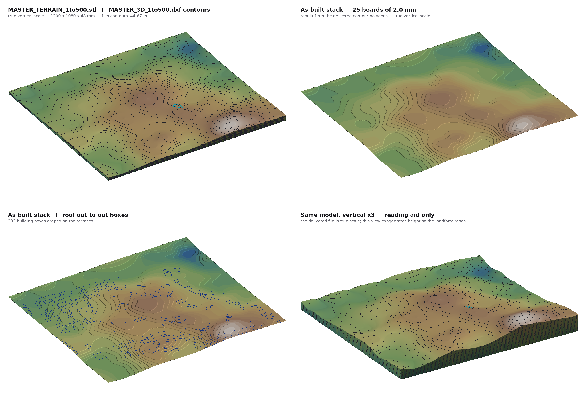
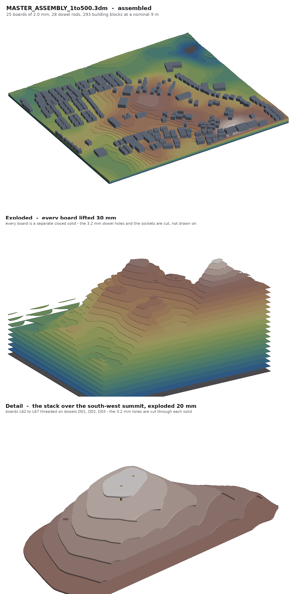
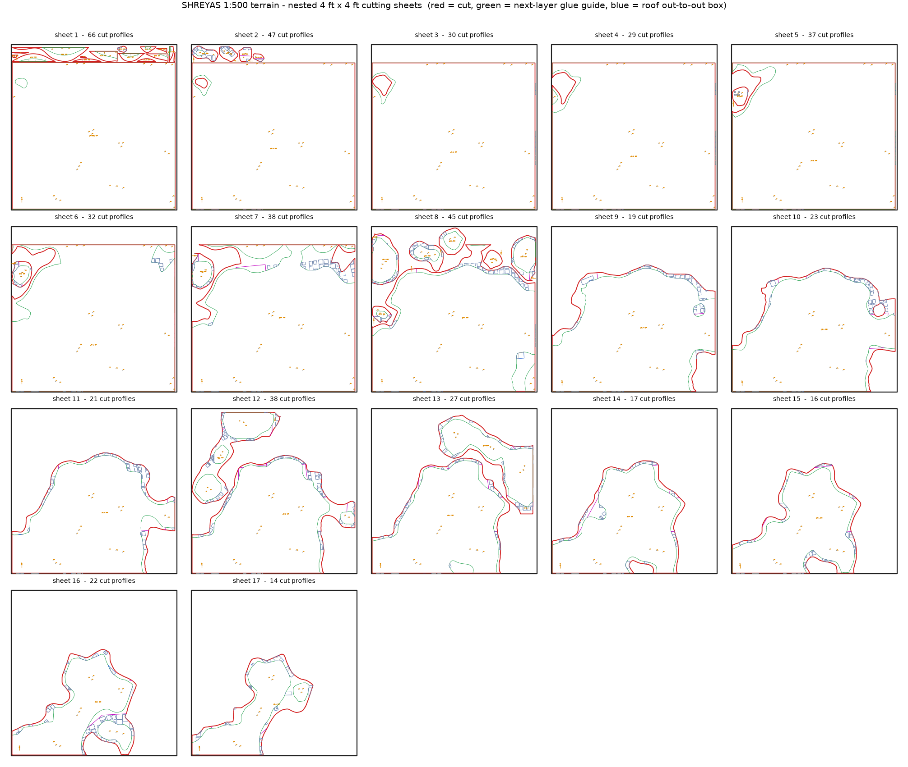
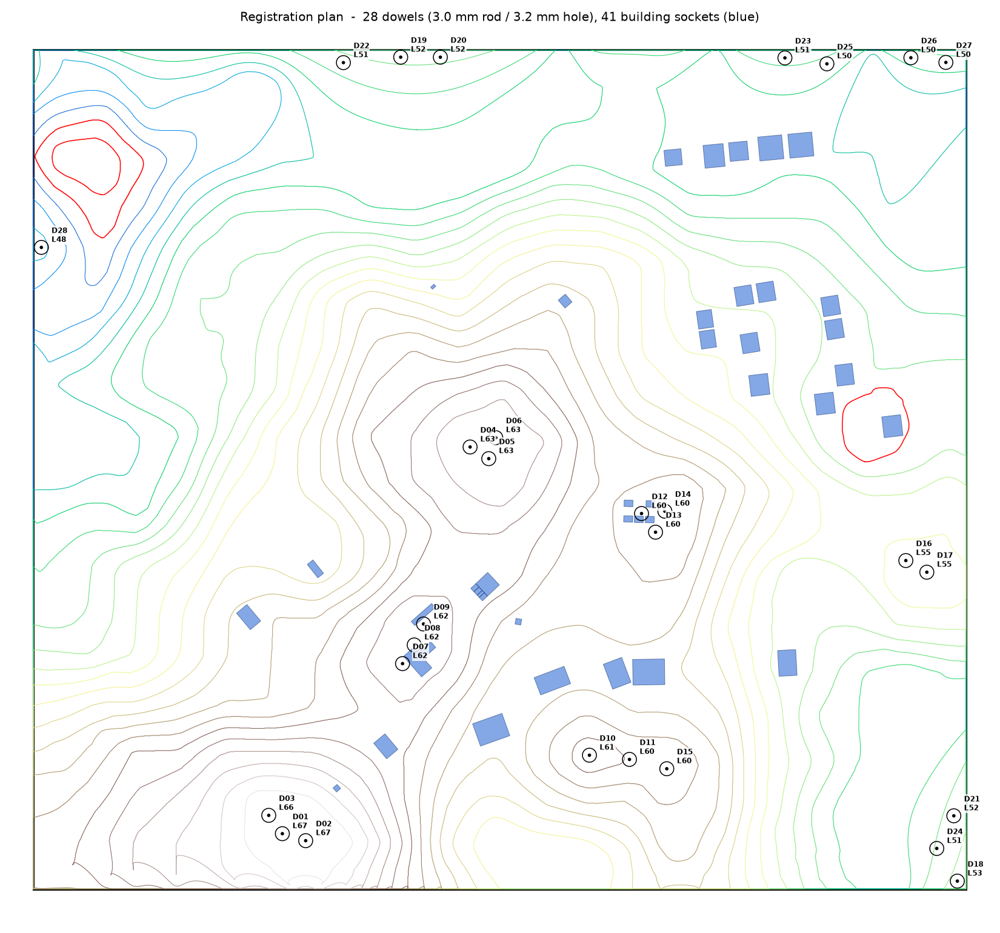
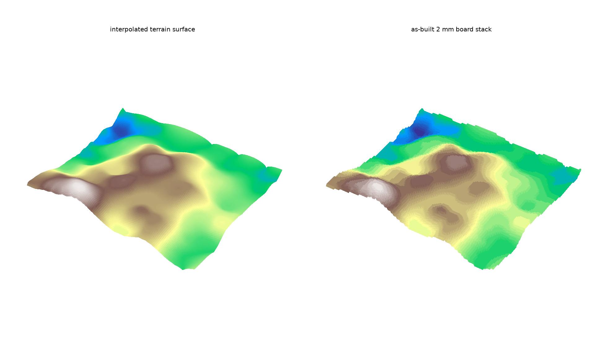

# SHREYAS — 1:500 CNC terrain model

A cut-ready contour model of the SHREYAS site (Ahmedabad), built from
`shreyasplancncrefrence.dwg` and `26_08_22_SHREYAS_RASTER_WITH_CONTOURS.pdf`.

| | |
|---|---|
| **Scale** | 1:500 |
| **Model size** | 1200 × 1080 × 50 mm (600 × 540 m of ground) |
| **Sheet** | 4 ft × 4 ft — 1219.2 × 1219.2 mm |
| **Board** | **2.0 mm** — this is not optional, see *Board thickness* |
| **Contour interval** | 1 m → 2 mm per layer |
| **Levels** | 44 – 67 m, 24 layers, on a base board at 43 m |
| **Sheets needed** | **17** of 4 × 4 ft × 2 mm (16.10 m² cut, 63.7 % utilisation) |
| **Total cut path** | 90.2 m |
| **Registration** | 28 dowels, 3.0 mm rod in 3.2 mm holes |
| **Validation** | 0 errors, 0 warnings — see `docs/verification.md` |



**Spin it:** `docs/model-viewer.html` is a self-contained WebGL viewer — orbit the
model, switch between the terrain surface and the as-built 2 mm board stack, turn
the contours and roof boxes on and off, and push the vertical scale past true to
read the landform. Everything in it is decoded from the delivered STL and DXF.

---

## What is in `output/`

### The Rhino model

| file | what it is |
|---|---|
| `MASTER_ASSEMBLY_1to500.3dm` | **The fabrication model.** Every board is a closed Extrusion solid with its cutouts already made — terrain holes, 3.2 mm dowel holes and building sockets are inner profiles of the solid, not curves drawn on top. Plus the 28 dowel rods, the building blocks and reference curves, on named Rhino layers, in millimetres. Opens and reports `IsSolid` in Rhino with nothing to repair. |
| `MASTER_3D_1to1.3dm` | The same site at full size as reference geometry: contours at true elevation on a layer per metre, a terrain mesh, roof footprints and out-to-out boxes. No boards or dowels — those are 1:500 fabrication features, and a 1 m thick "board" would be meaningless. |



### Rhino layers in the assembly

| layer | contents |
|---|---|
| `00_REFERENCE` | model boundary, contours, site boundary, water |
| `01_BASE_BOARD` | the 1200 × 1080 base, drilled for all 28 dowels |
| `02_BOARDS_2mm/L44 … L67` | one sublayer per metre, hypsometric colours |
| `03_DOWEL_RODS_3.0mm` | the rods, each running base board to its top board |
| `04_BUILDING_BLOCKS_nominal_9m` | 293 massing blocks — **the height is an assumption, not survey data**, which is why it is in the layer name |
| `05_ROOF_OUT_TO_OUT_BOXES` | the boxes as curves, draped on the terrain |

### The master 3-D model

| file | what it is |
|---|---|
| `MASTER_3D_1to1.dxf` | Full size. Millimetres, true site datum. Every contour as a **closed 3-D polyline at its own elevation** (`CONTOUR_44` … `CONTOUR_67`), plus building boxes and footprints draped on the terrain. |
| `MASTER_3D_1to500.dxf` | The same drawing at 1:500 — an exact ÷500 of the above, so the two stay in step. Base board top sits at Z = 86 mm (= 43 m ÷ 500); subtract 86 to put the base at zero. |
| `MASTER_TERRAIN_1to1.stl` | Terrain surface as a closed solid with a skirt down to the 43 m datum — feed straight to 3-axis CAM or a printer. 2 m sampling. |
| `MASTER_TERRAIN_1to500.stl` | Same solid at 1:500. |

### The cutting files

| file | what it is |
|---|---|
| `sheets_1to500/CNC_1to500_SHEET_01..17.dxf` | One file per 4 × 4 ft sheet, origin at the sheet corner, ready to load. Carries the 430 dowel holes and 41 building sockets as well as the outlines. |
| `DOWEL_SCHEDULE.csv` | Each dowel: position, top board, how many boards it pierces, rod length to cut. |
| `CNC_NEST_4x4ft_1to500_ALL.dxf` | All 17 sheets side by side in one drawing, for checking. |
| `CUT_LIST.csv` | Every piece: sheet, part id, level, rotation, size, area, perimeter, holes. |

### The roof out-to-out boxes

| file | what it is |
|---|---|
| `BUILDING_OUT_TO_OUT_1to1.dxf` | Every building's overall plan rectangle plus its true footprint, full size. |
| `BUILDING_OUT_TO_OUT_1to500.dxf` | The same at 1:500. |
| `BUILDING_OUT_TO_OUT_SCHEDULE.csv` | 319 buildings: long side, short side, bearing, area, centre, and whether it falls inside the model window. |

Out-to-out means the overall rectangle enclosing the roof in plan. For the
raster-traced context blocks — already drawn as rotated rectangles — that is the
rectangle itself. For the L- and T-shaped campus blocks it is the
minimum-area oriented bounding rectangle, which is what you would actually cut.

| | count in window | median out-to-out |
|---|---|---|
| raster-traced context buildings | 204 (229 total) | 15.5 × 12.2 m |
| campus building masses | 87 | 12.0 × 7.6 m |
| platforms | 2 | 26.1 × 13.6 m |
| water body | 1 | — |

---

## DXF layers on the cutting sheets

| layer | colour | what to do with it |
|---|---|---|
| `CUT_OUTER` | red | cut through — the outer profile of each piece |
| `CUT_INNER` | red | cut through **first** — terrain holes inside a piece |
| `CUT_DOWEL_3.2` | yellow | 3.2 mm registration holes — drill or mill |
| `CUT_SOCKET_BLDG` | cyan | building locating sockets — cut through |
| `ENGRAVE_NEXT` | green | score/engrave — outline of the layer that stacks on top |
| `ENGRAVE_BLDG_BOX` | blue | score — roof out-to-out boxes on the visible terrace |
| `ENGRAVE_BLDG_FOOTPRINT` | grey | score — true roof outlines |
| `ENGRAVE_SITE_BOUNDARY` | magenta | score — campus boundary |
| `ENGRAVE_TEXT` | yellow | score — part id and level, single-stroke so any CAM cuts it |
| `ENGRAVE_NORTH` | yellow | score — north arrow, rotated with the piece |
| `SHEET_EDGE` | white | reference only — **never cut this** |



---

## Board thickness — read this before ordering material

At 1:500 a 1 m contour interval is **exactly 2.0 mm**. The model is only true to
scale on 2 mm board.

If you can only get 3 mm, the model still assembles but every height is
exaggerated 1.5× — a 24 m rise reads as 36 m. That is a legitimate presentation
choice, but say so on the board. Do not mix thicknesses.

Suitable 2 mm stock: greyboard / mount board (cleanest edge, cheapest),
2 mm MDF, 2 mm birch ply, 2 mm acrylic.

---

## Registration

28 brass or beech rods of **3.0 mm** run up through the stack in **3.2 mm** holes.
Because a contour stack is nested — the ground at or above 51 m sits inside the
ground at or above 50 m — a dowel placed for a high board is inside every board
beneath it, so each rod serves one continuous run from the base board up to the
highest board that still holds it with full clearance. Every hole keeps at least
**4.0 mm of material** between its edge and any cut edge.

43 of the 46 cut pieces get at least one dowel; the three that are too small for
one are located by the outline engraved on the board below, which is exact.

**41 of the 293 buildings also get a locating socket** — their out-to-out box cut
through the board, so the block drops in on a 2 mm spigot and cannot shift. A
socket is only cut where the whole box sits inside one terrace with 3 mm to
spare and clear of every dowel; the other 252 blocks straddle a terrace edge,
where a socket would be ambiguous, so they stay engrave-only.



## Assembly

Every piece is engraved with the outline of the layer that sits on top of it, so
the stack registers itself — you never measure anything.

1. Cut all 17 sheets. Keep pieces sorted by level; the id (`L57-A`), the level
   (`57M`) and each dowel id (`D07`) are engraved on the piece itself.
2. Glue the base board (`L43-BASE`, the full 1200 × 1080 rectangle) to a stiff
   backing and stand the 28 rods in it. `DOWEL_SCHEDULE.csv` gives each rod's
   length; cut them a whisker long and trim flush at the end.
3. Working upward, thread each piece of level *L* onto its rods and glue it
   inside the green outline engraved on level *L−1*. The rods do the aligning;
   the engraved outline confirms it. The north arrow tells you which way round a
   piece goes — pieces cut rotated on the sheet still carry a correctly rotated
   arrow.
4. Levels 44 and 45 have a hole — the hollow in the north-west corner. Level 52
   has another, a small hollow on the east side. These are meant to be there.
5. Building out-to-out boxes are engraved on whichever terrace they land on, so
   a block spanning two terraces shows on both. 41 of them are cut sockets
   instead — drop those blocks in rather than gluing them on.
6. Trim the rod ends flush at the top board and fill the 3 mm dot. If you would
   rather no pin showed at all, pocket the top board's hole to 1.2 mm instead of
   cutting it through — that means flipping the piece for a second operation.

The finished stack is 25 boards — base plus 24 levels — 50 mm tall.



---

## Rebuilding from source

```bash
cd cnc/src
pip install ezdxf numpy scipy shapely matplotlib pymupdf pillow
python3 build.py --rebuild-dem        # ~5 min, DEM solve dominates
```

`build.py` runs the whole chain and finishes by reading its own DXF and STL output
back off disk and validating it. It exits non-zero if anything fails.

```bash
python3 make_previews_3d.py                # ~4 min, the 3-D views in docs/
python3 make_previews_assembly.py          # ~8 min, the assembly views in docs/
```

| module | job |
|---|---|
| `config.py` | scale, model window, level map, board thickness |
| `extract.py` | pull vector geometry out of the PDF, re-join the fragments |
| `terrain.py` | attach elevations, solve the DEM |
| `profiles.py` | slice the DEM into closed cut profiles per level |
| `buildings.py` | footprints and minimum-area out-to-out boxes |
| `emit3d.py` | master 3-D DXF and STL |
| `assembly.py` | dowel placement and building sockets |
| `emit_3dm.py` | the Rhino .3dm files |
| `nest.py` | shape-aware nesting onto 4 × 4 ft sheets |
| `emit_sheets.py` | cutting-sheet DXF and cut list |
| `emit_boxes.py` | standalone out-to-out box DXF and schedule |
| `stickfont.py` | single-stroke engraving font |
| `validate.py` | independent check of the emitted cutting sheets |
| `validate_3d.py` | independent check of the master 3-D DXF and STL |
| `validate_3dm.py` | independent check of the Rhino assembly |
| `render_3dm.py` | tessellates the .3dm for the assembly views |
| `render3d.py` | z-buffer renderer that reads the delivered STL/DXF back |
| `preview.py` | the sheet and plan images in `docs/` |
| `make_previews_3d.py` | the 3-D views, and the payload the viewer embeds |
| `make_previews_assembly.py` | the registration plan and the assembly views |

The DWG was read with LibreDWG (`dwg2dxf-converter`); the converted DXF is kept
in `source/` for reference, but the pipeline reads the PDF, which is the only
one of the two that carries the complete contour set.

---

## Two things worth knowing

**The contours had no elevations.** They were traced from a PDF and every one
sits at Z = 0 in the DWG. The 44–67 m values were recovered from the drawing's
own labels and cross-checked three ways; `docs/verification.md` is the full
record, including the seam test where two independently-derived assignments
agree to 0.00 pt.

**The drawing's lat/long graticule is nominal.** It implies a scale about 5 %
different from the CAD geometry, because the map was laid out in EPSG:4326 with
degrees as equal units. The model uses the CAD scale, which is calibrated on a
30 × 18 m basketball court and checked against six other known lengths to
0.000 %. Worth resolving before anyone re-georeferences this drawing.

**Two slivers were dropped.** Two fragments of the 61 m contour (1.87 m² and
1.41 m² of ground — 7.5 mm² and 5.6 mm² on the model) are smaller than a 2 mm
cutter can make and are not in the files.
